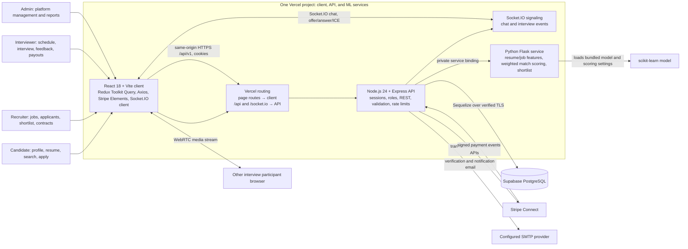

# OptaHire

**AI-assisted recruiting, built as a final-year project.** OptaHire brings candidates, recruiters, and interviewers into one workflow: candidates discover jobs and apply with a resume; recruiters review applicants and shortlist matches; teams schedule interviews, communicate in real time, and manage hiring contracts and payments.

The project’s FYP contribution is the connected workflow: structured recruitment data and candidate profiles feed an explainable, weighted matching service, while the same application carries a match into shortlisting, interviews, and hiring. It combines a PERN application with a Python ML service and browser-to-browser interview calling—an end-to-end system rather than a standalone resume classifier.

> Built by Computer Science students at the University of the Punjab, Gujranwala Campus. Contributions, issue reports, and stars help us improve and share the project.

[Live app](https://opta-hire-fyp.vercel.app/) · [Contribute](CONTRIBUTING.md) · [Issues](https://github.com/itxsaaad/opta-hire-ai-recruitment-fyp-app-pern/issues) · [Star on GitHub](https://github.com/itxsaaad/opta-hire-ai-recruitment-fyp-app-pern)

## How the system works

Candidates use the browser to build a profile, upload a resume, search openings, submit applications, and join interviews. Recruiters create openings, review applications and match scores, shortlist candidates, message them, and advance hiring through contracts and payments. Interviewers manage interview availability, join calls, submit ratings, and handle payout onboarding. The admin role uses management and reporting screens. REST requests and Socket.IO signaling pass through the API; video media is peer-to-peer WebRTC.

## Services

| Service | Code | Responsibility |
| --- | --- | --- |
| Web client | [`client/`](client/) | Role-based React experience, API calls, realtime UI, interview browser and Stripe UI |
| API | [`server/`](server/) | Express endpoints, authentication, PostgreSQL persistence, email, Stripe, Socket.IO and ML proxy |
| Matching service | [`ml-services/`](ml-services/) | Flask health/model endpoints and candidate-job scoring/shortlisting |

The root [`vercel.json`](vercel.json) configures all three services in one Vercel project. Production and the `develop` Preview now have the shared Supabase connection configured. Production and Preview also share payment/email credentials, so preview effects are real. The app uses in-process rate limiting and no external cache service. Heroku and Render remain available until the final data sync and hosted workflow checks pass.

## Get started

Install the client and API dependencies in their respective folders, provide each service’s ignored `.env` file based on its `.env.example`, then start the API (`npm run dev` in `server/`), client (`npm run dev` in `client/`), and Flask app (`python app.py` in `ml-services/`). Set the local ML service URL to `http://localhost:5001/` for the API proxy. See [local setup](docs/development/local-setup.md) for prerequisites, commands, ports, and configuration.

## Documentation

- [Architecture and user journeys](docs/architecture/README.md)
- [Feature workflows](docs/features/README.md)
- [API and realtime flows](docs/api/README.md)
- [Data model and migration runbook](docs/data/README.md)
- [Deployment and environment scopes](docs/operations/README.md)
- [Local development and conventions](docs/development/README.md)
- [Client guide](docs/services/client.md) · [API guide](docs/services/api.md) · [ML guide](docs/services/ml-service.md)
- [All documentation](docs/README.md)

## Contributing

We welcome improvements to accessibility, candidate matching, interview workflows, security, documentation, and deployment. Start with an issue or open a pull request describing the user problem, the implementation, and how you verified it. Please do not commit credentials, real candidate data, or generated environment files.

This project is licensed under the MIT License; see [`LICENSE`](LICENSE).
