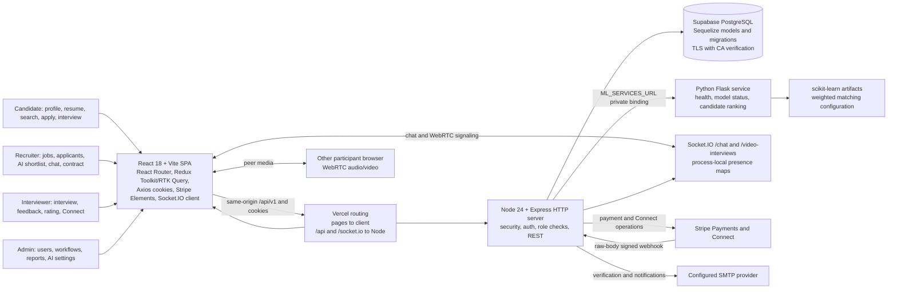

# Architecture

OptaHire is a role-based recruitment platform: candidates apply to openings, recruiters review and shortlist applicants, interviewers conduct sessions and record feedback, and admins operate the marketplace. This guide connects those user actions to the services, state, and external systems implementing them.

## System and interaction map

## User request lifecycle

1. A person opens a public or role-oriented route. React Router, client state and guards select the UI. Server authorization remains authoritative; hiding a button is not access control.
2. The screen calls a feature API through Axios/RTK Query at same-origin `/api/v1`, with cookies. Vercel routes `/api` and `/api/*` to Node.
3. Express applies request parsing, security/CORS, logging, in-memory rate limits, route middleware and controller logic. Sequelize reads/writes PostgreSQL.
4. For an AI shortlist, Express authorizes the role, loads the required context and calls Flask through the private `ML_SERVICES_URL` binding. Flask validates inputs, scores candidates and returns a recommendation. Express persists only the accepted workflow action.
5. Chat messages are persisted through the API; sockets deliver live events. Interview signaling uses sockets for room events and WebRTC offer/answer/ICE exchange, while media flows directly between browsers.
6. Stripe Elements collects payment details. Express holds secret keys and creates operations; Stripe events return to a signature-verified webhook using the raw request bytes.

## Why this design fits a small FYP

The single Vercel project gives a same-origin browser/API path while retaining separate client, Node and Python deployable services. Supabase supplies managed PostgreSQL. Flask isolates matching code from the system-of-record API. Redis/Upstash is intentionally absent to avoid another service cost. The tradeoffs—serverless sockets, in-memory limits, cold starts, shared preview data and ephemeral model writes—are described in [free-tier constraints](scaling-and-free-tier.md).

See [service boundaries](service-boundaries.md), [data flows](data-flows.md), [design decision](decisions/001-service-topology.md), and the [client](../services/client.md), [API](../services/api.md), and [ML](../services/ml-service.md) maps. Runtime source of truth: `vercel.json`, `server/app.js`, `server/routes/`, `server/sockets/`, and `ml-services/app.py`.
