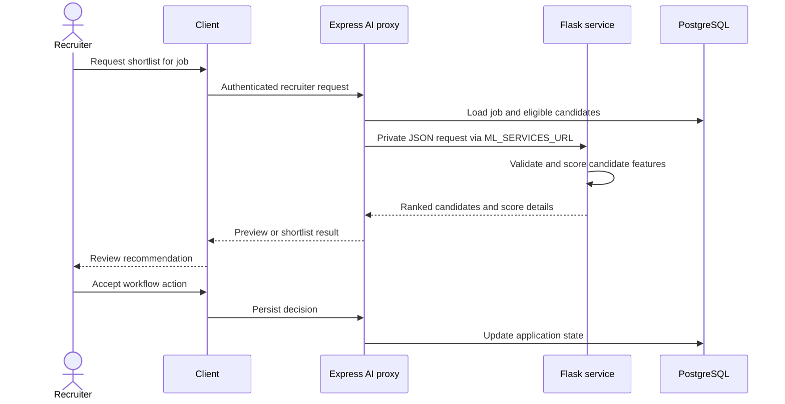

# End-to-end data flows

## Candidate application

```mermaid
sequenceDiagram
  actor C as Candidate
  participant UI as React client
  participant API as Express API
  participant DB as Supabase PostgreSQL
  C->>UI: Sign in, update profile/resume, choose job
  UI->>API: Cookie-authenticated /api/v1 calls
  API->>DB: Read user/resume/job; write application
  DB-->>API: Application state
  API-->>UI: Result and next step
  UI-->>C: Confirmation and application status
```

Exact required fields and transitions are in the application/resume controllers and Sequelize models. Consult [feature workflows](../features/README.md) and [data model](../data/models.md) before changing them.

## AI shortlist



Preview returns rankings without the normal shortlist persistence path. Model output is decision support; the recruiter owns the hiring decision.

## Chat, interview, and payment

Chat writes go through Express/PostgreSQL and socket events deliver live updates. The video namespace announces participants and carries WebRTC signaling; media itself is peer-to-peer. Payment goes from browser Stripe Elements to API and Stripe. Asynchronous events come back through the raw-body signature-verified webhook before transaction state changes.

## Failure/retry boundaries

The shared client request uses a 10-second timeout. A failed request should remain retryable where safe. Avoid duplicating non-idempotent application/payment writes. Socket reconnect/rejoin may lose transient presence. ML failure must not become an empty ranking. Database errors should not log connection strings or PII.
