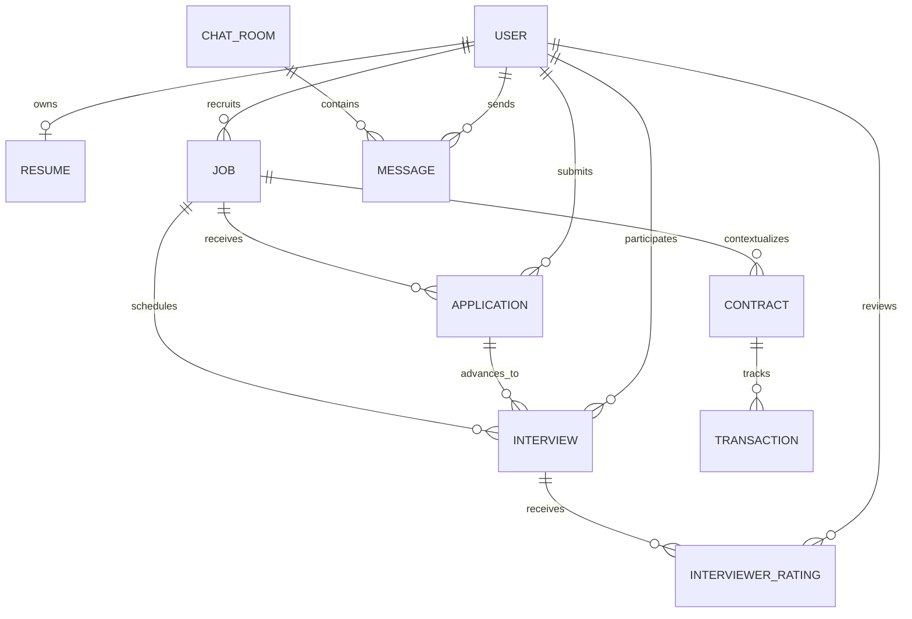

# Data model and ownership

Sequelize registers these entities in `server/models/index.js`; exact aliases, FK fields, constraints and delete rules are in model associations and migrations.

| Model | Responsibility | Relationships |
| --- | --- | --- |
| User | Candidate/recruiter/interviewer/admin identity | Resume, jobs, applications, chat, interview, contract, transactions |
| Resume | Candidate profile/resume details | Belongs to candidate |
| Job | Opening and requirements | Recruiter owner; applications, interviews, contracts |
| Application | Candidate submission and lifecycle | Job and candidate; interview workflow |
| ChatRoom | Participant conversation context | Contains messages |
| Message | Persisted chat content | Room, sender/recipient |
| Interview | Participants, schedule, state | Job, application, candidate, interviewer |
| Contract | Engagement record | Job/parties and transaction/rating context |
| Transaction | Payment state | Contract/payment lifecycle and users |
| InterviewerRating | Structured session feedback | Interview/job and reviewer/subject users |

This is conceptual, not a migration. Confirm nullable fields, exact FK names, unique constraints, status enums, indexes and cascade behavior in source and live schema. Messages are durable; socket IDs/presence and training process state are transient. A health check cannot prove database integrity.
